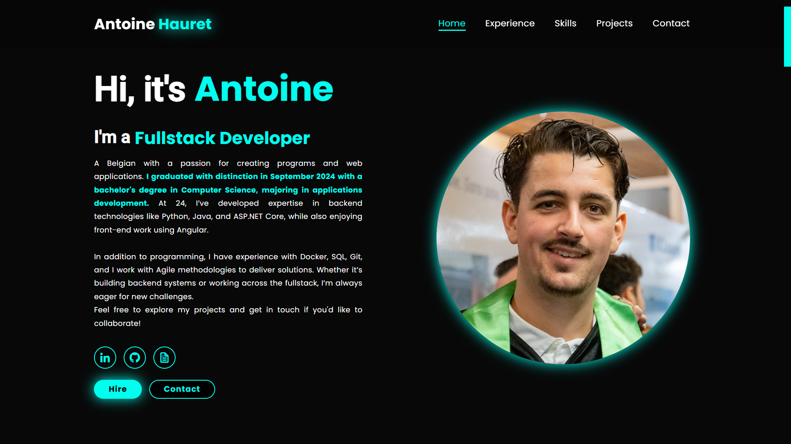

# My Portfolio



Source code of my personal portfolio, built with [Angular](https://angular.dev) (Angular CLI 22). It showcases my skills, experience, projects and education in a clean, interactive and responsive way, in **English, French (Belgium) and Dutch (Belgium)**.

## Features

- **Dynamic timeline** of my education, internships and professional experience.
- **Project showcase** built from my pinned GitHub repositories (generated at build time, see [Projects data](#projects-data)).
- **Technology stack** overview.
- **Multilingual**: Angular native i18n (en-GB, fr-BE, nl-BE).
- **Privacy-friendly**: GDPR privacy policy page, no cookies, no secrets shipped to the browser, contact email hidden from simple scrapers.
- **Responsive design** for mobile, tablet and desktop.

# Getting started

## Prerequisites

- Node.js `^22.22.3` (or `^24.15.0` / `>=26`), as required by Angular CLI 22
- npm (the repository uses `legacy-peer-deps=true` in `.npmrc`)

## Installation

```bash
git clone https://github.com/Antoinehrt/Portfolio.git
cd Portfolio
npm install
```

## Configuration

Two things must be configured locally. **Neither file is committed** (both are in `.gitignore`).

> **Rule of thumb:** anything placed in an Angular `environment` file ends up in clear text in the JavaScript bundle served to visitors. Never put a real secret there.

### 1. Angular environment files (EmailJS, contact form)

The contact form relies on [EmailJS](https://www.emailjs.com). Its three identifiers are designed to be public, so they are safe in the environment file. Create the environments:

```bash
ng generate environments
```

Then fill `src/environments/environment.ts` (and the `environment.development.ts` / `environment.staging.ts` variants used by the `development` and `staging` configurations):

```ts
export const environment = {
    production: false,
    EMAILJS_USER_ID: 'your-emailjs-user-id',
    EMAILJS_SERVICE_ID: 'your-emailjs-service-id',
    EMAILJS_TEMPLATE_ID: 'your-emailjs-template-id',
};
```

Because these identifiers are public, protect the form on the EmailJS side as well (Security settings of your account: allowed domains, reCAPTCHA, request limits, ...).

### 2. `.env` file (GitHub token, build time only)

The Projects section is generated **at build time** from my pinned GitHub repositories (GraphQL API). The token is only read by a Node script on your machine and is **never embedded in the app**.

1. Create a **fine-grained personal access token** with read-only access to public repositories and nothing else.
2. Create a `.env` file at the project root:

```bash
GITHUB_TOKEN=github_pat_xxxxxxxxxxxxxxxx
```

## Projects data

`scripts/fetch-projects.mjs` queries GitHub and writes `src/assets/data/projects.json`, which the app loads as a static asset.

```bash
npm run fetch:projects
```

- It runs automatically before `npm run build` (`prebuild` hook). It does **not** run with `ng build` or `ng serve`: use the npm scripts, or run `npm run fetch:projects` manually.
- Without `GITHUB_TOKEN`, the script keeps the existing `projects.json` and exits normally, so CI or other contributors can still build.
- `projects.json` is committed: only public data.
- Update the list of projects by re-running the script, then commit the result.

## Development server

```bash
ng serve                          # English (en-GB, source locale)
ng serve --configuration=fr       # French (fr-BE)
ng serve --configuration=nl       # Dutch (nl-BE)
```

Native i18n is applied at compile time, so each language needs its own configuration: `ng serve` alone only displays English.

## Internationalization (i18n)

- **Static texts** (templates): Angular native i18n with `i18n` attributes and stable custom ids (e.g. `i18n="@@privacy.title"`). Translations live in `src/assets/data/locales/`:
    - `portfolio.xlf`: source file (en-GB), generated
    - `portfolio.fr.xlf`: French (Belgium)
    - `portfolio.nl.xlf`: Dutch (Belgium)
- **Dynamic content** (experience timeline): locale JSON files in `src/assets/data/` (`en-GB.json`, `fr-BE.json`, `nl-BE.json`).

Workflow when adding or changing a text:

1. Add the `i18n="@@some.id"` attribute (use `i18n-placeholder`, `i18n-aria-label`, ... for attributes).
2. Extract the source file (it is **overwritten**, existing translations are not touched):

   ```bash
   ng extract-i18n --format xlf --output-path src/assets/data/locales --out-file portfolio.xlf
   ```

3. In `portfolio.fr.xlf` and `portfolio.nl.xlf`, add a `<target>` for each new or changed `<trans-unit>` (keep the `<x .../>` placeholders identical to the source).
4. Check with `ng serve --configuration=fr` and `ng serve --configuration=nl`.

## Build for production

```bash
npm run build
```

This fetches the projects, then builds all locales (`"localize": true`) into:

```
dist/portfolio/browser/
├── en-GB/
├── fr-BE/
└── nl-BE/
```
# File structure

```
.
├── scripts/
│   └── fetch-projects.mjs        // Build-time GitHub fetch (uses .env)
└── src/
    ├── app/
    │   ├── pages/                // Page-level components (home, experiences, projects, privacy, ...)
    │   └── core/
    │       ├── models/           // TypeScript interfaces
    │       ├── pipes/            // Pipes
    │       ├── services/         // Services (projects, static data, experience)
    │       ├── shared/           // Reusable components (protected email)
    │       ├── utils/            // Helpers (contact email)
    │       └── style/            // Shared styles
    ├── assets/
    │   ├── data/                 // projects.json, locale JSON files, locales/ (XLIFF)
    │   └── img/
    └── environments/             // Local environment files (not committed)
```

# License

Logos used in this portfolio are the property of their respective owners and are shown here for illustrative purposes only. No copyright infringement is intended.

# Contact

- **LinkedIn**: [/in/antoine-hauret](https://www.linkedin.com/in/antoine-hauret)
- **Contact form**: available on the portfolio website
